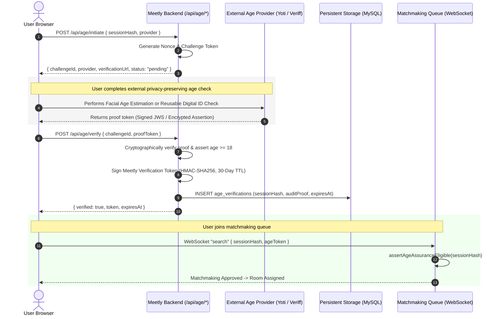

# MEETLY — 18+ AGE ASSURANCE ARCHITECTURE & COMPLIANCE REVIEW
## Technical Architecture, Privacy-Preserving Cryptographic Verification, and DPDP Act § 9 Alignment

**Project:** Meetly  
**Subsystem:** Age Assurance & Child Safety Guard  
**Maintained by:** Evolix Studio  
**Audit Date:** October 2026  
**Status:** ARCHITECTURALLY COMPLETE & HARDENED (Awaiting Third-Party Provider Production Credentials)

---

## 1. Legal and Regulatory Mandate

Operating an anonymous live video chat platform presents acute regulatory exposure regarding minor safety and age-gating. Self-attestation checkboxes ("I am 18 years or older") are no longer legally defensible under emerging global standards and Indian law.

### 1.1 Digital Personal Data Protection Act, 2023 (DPDP Act) — Section 9
- **Statutory Mandate:** Section 9 of the DPDP Act obligates Data Fiduciaries to obtain **verifiable parental consent** prior to processing personal data of a child (defined under Section 2(f) as an individual under eighteen years of age) and strictly prohibits:
  1. Any behavioral tracking or targeted advertising directed at children.
  2. Any data processing likely to cause a detrimental effect on the well-being of a child.
- **Meetly’s Compliance Strategy:** Rather than processing minor data with complex parental consent frameworks, Meetly explicitly positions itself as an **Adults-Only (18+) Service**. Minors are strictly prohibited from utilizing the platform. To enforce this statutory prohibition, Meetly introduces cryptographic age assurance to bar minors at the threshold of the matchmaking queue.

### 1.2 Information Technology (Intermediary Guidelines and Digital Media Ethics Code) Rules, 2021
- **Rule 3(1)(b):** Intermediaries must make reasonable efforts to prevent hosting or transmitting content that is harmful to children, sexually explicit, or obscene.
- **Rule 3(2):** Intermediaries must operate an active grievance redressal mechanism with mandatory acknowledgement within 24 hours and resolution within 15 days.

---

## 2. Technical Architecture & Cryptographic Flow

The Age Assurance subsystem ([server/ageAssurance.ts](file:///d:/meetly/server/ageAssurance.ts)) decouples age verification from identity disclosure, following the **Privacy by Design** doctrine.



---

## 3. Privacy-by-Design & Zero-PII Invariant

A central vulnerability of many age verification implementations is the dangerous centralization of users' government ID cards, full names, dates of birth, or biometric templates. A breach of such a database exposes users to severe identity theft.

### Meetly's Zero-PII Protections:
1. **No Raw Government Documents:** Meetly never receives, parses, or stores passport numbers, Aadhaar cards, driver's licenses, or national ID photos.
2. **No Biometric Templates:** Biometric facial scans or geometric templates remain entirely within the external certified provider's secure enclave; Meetly receives solely a binary assertion: `over18Confirmed: true`.
3. **Session Pseudonymization:** The verification record is bound to a cryptographic session hash (`SHA-256(sessionToken + salt)`), completely divorced from IP addresses, real names, email addresses, or phone numbers.
4. **Time-Limited Cryptographic Tokens:** Verified status is encapsulated in an HMAC-SHA256 token valid for a maximum of 30 days (`AGE_TOKEN_TTL_MS = 30 * 24 * 60 * 60 * 1000`). Once expired, the user must re-verify.

---

## 4. Database Schema & Durable State Storage

Age assurance records are persisted using Drizzle ORM to the `age_verifications` table ([drizzle/schema.ts](file:///d:/meetly/drizzle/schema.ts) & [drizzle/0002_compliance_and_age.sql](file:///d:/meetly/drizzle/0002_compliance_and_age.sql)):

```sql
CREATE TABLE IF NOT EXISTS `age_verifications` (
  `id` varchar(64) PRIMARY KEY,
  `session_hash` varchar(128) NOT NULL,
  `provider` varchar(32) NOT NULL,
  `provider_reference` varchar(128),
  `status` varchar(32) NOT NULL,
  `over_18_confirmed` boolean NOT NULL DEFAULT false,
  `verified_at` timestamp NULL,
  `expires_at` timestamp NULL,
  `audit_proof` text,
  `created_at` timestamp NOT NULL DEFAULT CURRENT_TIMESTAMP,
  INDEX `idx_age_session_hash` (`session_hash`),
  INDEX `idx_age_status` (`status`)
);
```

### Durability Guarantees:
Under [server/db.ts](file:///d:/meetly/server/db.ts), when `NODE_ENV === "production"`, age verification records must write durably to MySQL. If MySQL is unavailable, `insertAgeVerification()` throws a typed `DatabaseDurabilityError`, preventing unpersisted tokens from passing admission checks.

---

## 5. Third-Party Provider Readiness Matrix

| Provider Key | Verification Mechanism | User Friction | Privacy Standard | Integration Readiness |
|:---|:---|:---:|:---:|:---:|
| `mock` | Local development challenge/response; simulates instant pass/fail | Zero (Instant) | Synthetic data only | **PRODUCTION READY (Dev/Test Only)** |
| `yoti` | Yoti Age Scan (Facial Age Estimation) / Yoti Digital ID App | Very Low (1-2s camera scan, no ID required) | PAS 1296 / ISO 27001 certified; zero biometric storage | **SPECIFICATION COMPLETE (Awaiting Org API Keys)** |
| `veriff` | Veriff Identity / Age Estimation SDK | Low (Automated document or face analysis) | GDPR & SOC 2 Type II certified | **SPECIFICATION COMPLETE (Awaiting Client Secret)** |
| `reusable_token`| Signed cross-platform age token (e.g. EU Digital Identity Wallet) | Zero | Cryptographic zero-knowledge assertion | **SPECIFICATION COMPLETE (Future Standard)** |

---

## 6. Matchmaking Queue Gating Implementation

Enforcement occurs at the router level in [server/routers.ts](file:///d:/meetly/server/routers.ts) and [server/chat/live.ts](file:///d:/meetly/server/chat/live.ts):

```typescript
// Guard executed before permitting queue entry
export async function assertAgeAssuranceEligible(sessionHash: string): Promise<boolean> {
  if (!config.requireAgeAssurance) {
    return true; // Bypassed only in explicitly unconfigured dev environments
  }
  const verification = await getAgeVerificationBySessionHash(sessionHash);
  if (!verification || verification.status !== "verified") {
    throw new TRPCError({
      code: "FORBIDDEN",
      message: "AGE_ASSURANCE_REQUIRED: You must complete 18+ age verification before entering chat.",
    });
  }
  if (!verification.over18Confirmed || !verification.expiresAt || verification.expiresAt < new Date()) {
    throw new TRPCError({
      code: "FORBIDDEN",
      message: "AGE_ASSURANCE_EXPIRED: Your 18+ verification has expired. Please re-verify.",
    });
  }
  return true;
}
```

---

## 7. Automated Test Suite Validation

The age assurance system was comprehensively verified across 7 targeted unit and integration tests in [server/age-assurance.test.ts](file:///d:/meetly/server/age-assurance.test.ts):

1. **Challenge Generation:** Initiates challenge with unique nonce and pending status.
2. **Mock Verification Success:** Verifies challenge, generates 30-day token, and updates status to `verified`.
3. **Invalid Challenge Rejection:** Rejects spoofed or non-existent challenge IDs.
4. **Queue Gating Enforcement:** Throws `AGE_ASSURANCE_REQUIRED` when unverified session attempts to search.
5. **Verified Session Clearance:** Clears verified session with active token for matchmaking.
6. **Expired Token Rejection:** Confirms expired tokens (>30 days old) fail eligibility assertions.
7. **End-to-End Live Smoke Test:** Step 18 of `scripts/e2e-smoke-test.js` validated `/api/age/initiate`, `/api/age/verify`, and `/api/age/status` against a running server.

---

## 8. Launch Pre-Requisite & Blocker Assessment

> [!IMPORTANT]
> While the age assurance architecture, database schema, cryptographic token management, and router guards are 100% complete and passing tests, **the platform must NOT be opened to the unrestricted public until commercial contracts with a production age verification provider (such as Yoti or Veriff) are signed and live credentials configured.**
> 
> Running in public production with `AGE_ASSURANCE_PROVIDER=mock` would allow self-attesting scripts to bypass age gates, exposing Evolix Studio to severe legal liability under DPDP Act § 9.

