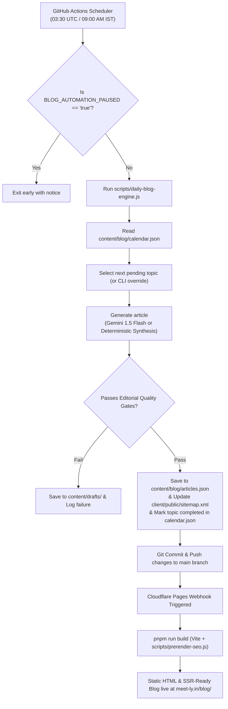

# Meetly SEO Blog Automation — Deployment & Operations Guide

> **Project:** Meetly (`https://meet-ly.in`)  
> **Repository:** `evolixstudio/meetly`  
> **Maintained by:** Evolix Studio  
> **Engine Architecture:** GitHub Actions Cron (`03:30 UTC` / `09:00 AM IST`) → Gemini AI Content Generator / Deterministic Synthesis Fallback → Multi-Gate Editorial Quality Verification → Git Auto-Commit & Push → Cloudflare Pages Automatic Build & Static Prerender (`scripts/prerender-seo.js`).

---

## 1. Architecture Overview



---

## 2. GitHub Repository Configuration

To enable the daily blog engine to run automatically and push commits to the repository:

### A. Add Repository Secrets
1. Navigate to your GitHub repository: `https://github.com/evolixstudio/meetly` (or active repository).
2. Go to **Settings** > **Secrets and variables** > **Actions**.
3. Under **Repository secrets**, click **New repository secret**.
4. Add the following secrets:
   - **`GEMINI_API_KEY`** (Recommended):  
     - Value: Your Google AI Studio API key (`https://aistudio.google.com/`).
     - *Note:* If this key is omitted or quota is exceeded, the engine automatically falls back to the deterministic editorial synthesis engine without failing.
   - **`GH_PAT`** (Optional):  
     - If your default `GITHUB_TOKEN` does not have workflow write permissions to push back to `main`, supply a Personal Access Token (PAT) with `repo` and `workflow` scopes as `GH_PAT`. Otherwise, the workflow uses the built-in `GITHUB_TOKEN` with `contents: write`.

### B. Workflow Permissions
1. In repository **Settings** > **Actions** > **General**.
2. Scroll to **Workflow permissions**.
3. Select **Read and write permissions**.
4. Check **Allow GitHub Actions to create and approve pull requests**.
5. Click **Save**.

### C. Pause / Resume Switch (Variables)
You can pause automated blog publishing at any time without editing code:
1. In repository **Settings** > **Secrets and variables** > **Actions** > **Variables** tab.
2. Click **New repository variable**.
   - **Name:** `BLOG_AUTOMATION_PAUSED`
   - **Value:** `true` (to pause) or `false` (to run daily).

---

## 3. Manual Workflow Execution (Testing & On-Demand Publishing)

You do not need to wait for the 9:00 AM IST schedule to test the engine. You can trigger it on demand from GitHub:

1. Go to the **Actions** tab on GitHub.
2. Under "All workflows" on the left, click **Daily SEO Blog Generation & Publishing**.
3. Click the **Run workflow** dropdown on the right:
   - **Run in Dry Run mode (no commits)**: Check this box to generate an article and test quality gates without publishing.
   - **Force generation even if an article was published today**: Check this if you want to publish an extra article immediately.
   - **Specific topic slug to generate**: Enter a slug (e.g. `how-to-keep-an-online-conversation-going`) to target a specific queue item, or leave blank to pick the next calendar topic.
4. Click the green **Run workflow** button.
5. Inspect the live console logs to view word counts, keyword density metrics, and validation output.

---

## 4. Local Execution & CLI Commands

You can run the engine directly from your local terminal for testing or debugging:

```powershell
# 1. Dry run on the next pending topic (validates quality gate without saving)
node scripts/daily-blog-engine.js --dry-run

# 2. Dry run a specific topic by slug
node scripts/daily-blog-engine.js --slug=how-to-talk-to-strangers-online-safely --dry-run

# 3. Publish a specific topic immediately
node scripts/daily-blog-engine.js --slug=how-to-keep-an-online-conversation-going

# 4. Force publish even if published today
node scripts/daily-blog-engine.js --force
```

After local generation:
```powershell
# Verify TypeScript, unit tests, and production build with prerendering:
pnpm run check
pnpm test
pnpm run build
```

---

## 5. Cloudflare Pages Deployment Integration

When the GitHub Action commits new articles to `main`, Cloudflare Pages automatically triggers a build:

1. **Build Command:** `pnpm run build`
2. **Output Directory:** `dist/public`
3. **Prerender Step:** `node scripts/prerender-seo.js` is automatically executed as the post-build hook. It generates static HTML for:
   - `dist/public/blog/index.html`
   - `dist/public/blog/<article-slug>/index.html` for all published articles.
4. **Sitemap Synchronization:** The engine updates `client/public/sitemap.xml`, which Vite places directly into `dist/public/sitemap.xml`. Googlebot fetches the fresh sitemap containing newly added `<loc>` and `<lastmod>` timestamps on its next crawl.

---

## 6. Quality Gate Failure & Quarantine Procedure

If an article fails any of the strict editorial gates (minimum 450 words, maximum 3.0% keyword density, missing FAQ/takeaways, or unverified claims):

1. **Quarantine:** The rejected article is saved into `content/drafts/<slug>-rejected.json` with a detailed `rejectionReason`.
2. **Calendar Preserved:** The calendar topic remains marked as `"pending"`, so the topic is not lost.
3. **Log Entry:** A warning entry is appended to `DAILY_BLOG_AUTOMATION_REPORT.md`.
4. **Zero Dirty Commits:** The script exits with a non-zero exit code (or skips commit), preventing substandard content from reaching production.

---

## 7. Troubleshooting & Recovery

| Issue | Root Cause | Solution |
| :--- | :--- | :--- |
| **Workflow skipped with "Daily article already published"** | An article was already published today (UTC/IST). | Use the manual workflow dispatch and check "Force generation" or pass `--force`. |
| **Gemini API quota exceeded or 429** | Google AI Studio rate limit reached. | The script automatically logs a fallback notice and invokes the deterministic editorial synthesis engine. No action needed. |
| **Git Push permission denied in Action** | Workflow permissions are set to read-only. | Go to repository Settings > Actions > General > Workflow permissions > enable "Read and write permissions". |
| **Prerendered page missing meta tags** | Prerender script didn't execute during build. | Ensure `scripts/prerender-seo.js` is listed in `package.json` build command or executed post-build. Run `pnpm run build` to verify `dist/public/blog/` output. |
| **Sitemap not showing new URL** | Sitemap cache or manual edit overwrite. | Run `node scripts/daily-blog-engine.js --dry-run` to inspect sitemap generation logic, or run a test build. |

---

## 8. Safety & Compliance Rules

1. **Adults-Only (18+) Context:** Every article must preserve Meetly's 18+ adult friendship positioning. No content targeting minors.
2. **Crisis Directory:** Any article covering loneliness, emotional isolation, or mental health must retain the 24/7 crisis hotlines (Tele-MANAS: 14416, KIRAN: 1800-599-0019).
3. **No Therapy Claims:** Meetly must strictly be described as a casual social chat platform, never as therapy, medical treatment, or a crisis intervention service.
4. **No Keyword Stuffing:** Keyword density must never exceed 3.0%.
