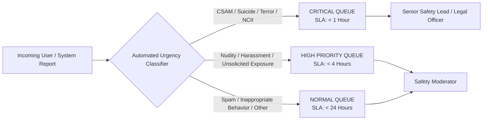
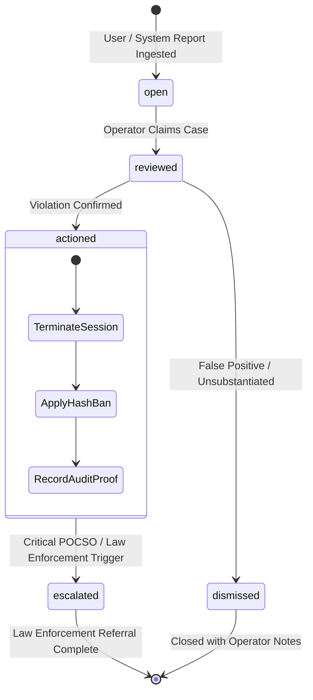

# MEETLY — TRUST & SAFETY MODERATION OPERATIONS MANUAL
## Standard Operating Procedures, Statutory Triage Protocols, Incident Escalation, and Operator CLI

**Project:** Meetly  
**Subsystem:** Trust & Safety and Content Moderation  
**Maintained by:** Evolix Studio  
**Effective Date:** October 2026  
**Audience:** Trust & Safety Officers, Compliance Operators, and Legal Representatives

---

## 1. Operating Principles & Statutory Mandates

Meetly operates under a strict **Zero-Tolerance Policy** for Child Sexual Abuse Material (CSAM), non-consensual intimate imagery (NCII), hate speech, terrorism, and unsolicited sexual exposure.

As an intermediary operating in India, Meetly complies with:
1. **Rule 3(1)(b) & Rule 3(2) of the Information Technology (Intermediary Guidelines and Digital Media Ethics Code) Rules, 2021:** Mandatory receipt and acknowledgement of user complaints within 24 hours, and statutory resolution within 15 days (or 72 hours for content removal orders).
2. **Protection of Children from Sexual Offences (POCSO) Act, 2012:** Mandatory obligation to report any material depicting or involving child sexual abuse to law enforcement authorities immediately upon identification.
3. **Sections 67, 67A, and 67B of the Information Technology Act, 2000:** Penal prohibitions against transmitting sexually explicit acts, child pornography, or electronic obscenity.

---

## 2. Priority Classification & SLA Framework

All incoming user reports and system-triggered safety flags are ingested through the automated prioritization engine and dispatched into segregated triage queues:



### SLA Targets & Enforcement Table

| Priority Level | Qualifying Incident Categories | Response Time SLA | Statutory Resolution SLA | Assigned Responder | Escalation Path |
|:---|:---|:---:|:---:|:---:|:---|
| **CRITICAL** | Child sexual abuse or exploitation (CSAM), non-consensual sexual depiction, terroristic threats, active self-harm / suicide threats. | **< 15 minutes** | **< 1 hour** | Chief Trust Officer / Grievance Officer | Immediate police / NCRB escalation; National Cyber Crime Reporting Portal (`cybercrime.gov.in`). |
| **HIGH** | Full frontal nudity, flashing, sexual harassment, explicit solicitation, impersonation. | **< 1 hour** | **< 4 hours** | Tier 1 Safety Moderator | Permanent cryptographic hash ban; device fingerprint revocation. |
| **NORMAL** | Commercial spam, bot automation, trolling, excessive profanity, bad connectivity abuse. | **< 12 hours** | **< 24 hours** | Tier 1 Safety Moderator | Temporary shadow-ban; session disconnection. |

---

## 3. Incident Lifecycle & Moderation State Machine

Every report progresses through a rigorous, immutable state machine:



### Mandatory Case Notes & Audit Trail:
- Every action taken by a moderator must be accompanied by a signed reason code and descriptive note.
- The system automatically timestamps each transition, records the moderator's cryptographic identifier, and ensures audit immutability in the database.

---

## 4. Moderation CLI Utility Guide (`scripts/moderation-cli.js`)

Operators can securely inspect, filter, and act on cases directly from a hardened shell environment without needing an exposed web admin panel.

### 4.1 Authentication & Invocation
```powershell
# Set operator administrative authorization
$env:MODERATION_API_KEY="your-secure-admin-token"

# Invocable via node or pnpm script
node scripts/moderation-cli.js <command> [arguments]
```

### 4.2 Primary Operator Commands

#### 1. System Incident Statistics (`stats`)
Displays real-time queue counts segregated by urgency:
```powershell
node scripts/moderation-cli.js stats
```
*Sample Output:*
```json
{
  "total": 42,
  "open": 8,
  "reviewed": 4,
  "actioned": 26,
  "closed": 4,
  "criticalOpen": 1,
  "highPriorityOpen": 2
}
```

#### 2. Priority Triage Queue (`triage`)
Lists urgent (`critical` and `high`) pending cases requiring immediate operator intervention:
```powershell
node scripts/moderation-cli.js triage
```

#### 3. Full Report List (`list`)
Filters cases by specific status or priority level:
```powershell
node scripts/moderation-cli.js list --status open --priority critical
```

#### 4. Case Review & Claim (`review`)
Claims a report and sets status to `reviewed`:
```powershell
node scripts/moderation-cli.js review <reportId> --note "Reviewing user reported screen context"
```

#### 5. Taking Enforcement Action (`action`)
Applies sanctions (bans, disconnects) and closes the report:
```powershell
node scripts/moderation-cli.js action <reportId> --action ban --note "Confirmed intentional flashing; session and hash permanently banned"
```

#### 6. Direct Hash / IP Banning (`ban`)
Manually blacklists a cryptographic session hash or network identifier:
```powershell
node scripts/moderation-cli.js ban <sessionHash> --reason "Repeat offender automated script"
```

---

## 5. Law Enforcement Escalation & Mandatory Reporting Protocol

### 5.1 CSAM & POCSO Act Mandatory Escalation
Under Indian law (POCSO Act § 19 & § 21), failure to report child abuse is a punishable criminal offense.

**Mandatory Immediate Protocol:**
1. **Immediate Quarantine:** Terminate active sessions associated with the identifier immediately.
2. **Preserve Metadata:** Freeze associated connection metadata (connection timestamp, cryptographic IP hash, port, signaling records) for statutory preservation under Rule 3(1)(h) of the IT Rules 2021 (mandating data preservation for 180 days upon lawful notice).
3. **National Cyber Crime Portal Ingestion:**
   - Navigate to [cybercrime.gov.in](https://cybercrime.gov.in) (National Cyber Crime Reporting Portal).
   - Lodge an urgent intermediary report under the **Child Sexual Abuse Material (CSAM)** category.
   - Record the statutory complaint registration number into the Meetly audit ticket.
4. **NCMEC Coordination:** File CyberTipline report if international actors or US-based intermediary infrastructure is implicated.

---

## 6. Grievance Officer Escalation Protocol (Rule 3(2))

In accordance with Rule 3(2) of the Information Technology (Intermediary Guidelines) Rules:
- All communications received at `grievance@meetly.evolix.in` or via `/api/grievance/submit` are assigned a unique tracking number (`GRV-YYYYMMDD-XXXXXXXX`).
- An automated acknowledgement email/receipt is dispatched within **24 hours**.
- The designated Grievance Officer reviews all submitted evidence and records the resolution in the persistent ticket record within **15 days**.

