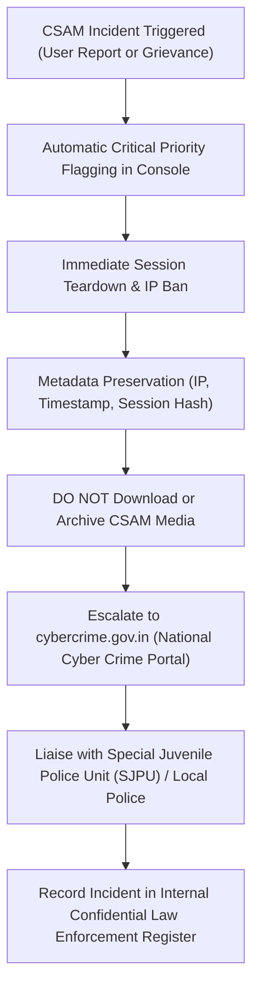

# INCIDENT RESPONSE & SAFETY ESCALATION SOP: MEETLY
**Platform:** Meetly (Anonymous Random Text & Video Chat)  
**Operator:** Evolix Studio  
**Date:** October 29, 2026  
**Applicable Regulations:** IT Rules 2021, CERT-In Directions 2022, POCSO Act 2012, DPDP Act 2023  
**Document Status:** Standard Operating Procedure (Internal Trust & Safety Operations)

---

## 1. INCIDENT SEVERITY CLASSIFICATION

| Severity Level | Trigger Events | Statutory / Regulatory Timeline | Immediate Action Required |
| :--- | :--- | :--- | :--- |
| **P0: CRITICAL** | 1. Child Sexual Abuse Material (CSAM) / Child Exploitation<br>2. Non-Consensual Intimate Imagery / Revenge Porn<br>3. Severe Cyber Breach / Server Intrusion / Data Compromise | **Immediate / 6 Hours (CERT-In) / 24 Hours (Rule 3(2)(b))** | Immediate session termination, IP ban, law enforcement referral, CERT-In notification within 6h, Grievance Officer review. |
| **P1: HIGH** | 1. Credible threats of mass violence or self-harm<br>2. Coordinated cyberattack (DDoS, API flooding)<br>3. Persistent targeted harassment / doxxing | **Within 24 Hours** | Moderator intervention, rate-limiting escalation, firewall block, user grievance acknowledgment. |
| **P2: MEDIUM** | 1. Automated spam or commercial advertising bots<br>2. Minor policy disputes or reporting feedback<br>3. Standard DPDP data subject access requests | **Within 48 Hours to 15 Days** | Automated/manual moderation triage, routine ticket update, statutory disposal within 15 days. |

---

## 2. P0 WORKFLOW: CHILD SEXUAL ABUSE MATERIAL (CSAM) & MINOR SAFETY

> [!CAUTION]
> **CRITICAL LEGAL NOTICE REGARDING CSAM**  
> Under Section 67B of the Information Technology Act and Section 19 of the POCSO Act, **it is a criminal offence to possess, copy, download, or re-transmit child sexual exploitation material**, even for the purpose of investigating a complaint. Never download, screenshot, or store full-resolution copies of suspected CSAM.



### Action Protocol for Duty Officers:
1. **Immediate Quarantine:**  
   Terminate the offending session immediately via the Moderation Console or CLI:
   ```bash
   node scripts/moderation-cli.js
   ```
2. **Metadata Preservation:**  
   Preserve strictly the technical metadata:
   - Client IP address and port
   - UTC timestamp of room creation and messages
   - Cryptographic session hash
   - Reporter's statement
   Do NOT save, download, or redistribute offending media files.
3. **Statutory Police Escalation:**  
   File an emergency report on the **National Cyber Crime Reporting Portal**:
   - URL: [https://cybercrime.gov.in](https://cybercrime.gov.in)
   - Category: "Child Sexual Abuse Material (CSAM)"
   - Provide the preserved network metadata and timestamps.
4. **Log Retention Tagging:**  
   Flag the relevant IP and connection logs to prevent automated deletion at the end of the rolling 180-day window, pending judicial or police instructions.

---

## 3. P0 WORKFLOW: EMERGENCY NON-CONSENSUAL INTIMATE IMAGERY TAKEDOWN (RULE 3(2)(b))

Under Rule 3(2)(b) of the Information Technology Rules, 2021, when a complaint or notice is received alleging that content depicts an individual in nudity, sexual acts, or bodily privacy violations without consent:

1. **24-Hour Statutory Clock:**  
   The Grievance Officer and On-Call Engineers have a strict **24-hour statutory deadline** to act.
2. **Verification & Blacklisting:**  
   - Review the grievance ticket submitted via `/grievance` (categorized under `content_removal` or `privacy_complaint`).
   - Identify the accused user session hash, IP address, and room metadata.
   - Immediately terminate any active session associated with the reported identifier.
   - Add the IP address to the temporary network blacklist.
3. **Formal Resolution:**  
   Update the grievance ticket status to `actioned` via `updateGrievanceTicketStatus(ticketCode, "actioned", notes)`.
4. **Complainant Notification:**  
   Issue written confirmation to the complainant via the registered email within the 24-hour statutory window, detailing that access has been disabled.

---

## 4. P0 WORKFLOW: CERT-IN MANDATORY 6-HOUR CYBERSECURITY REPORTING

Under Paragraph 5(i) of the CERT-In Directions dated 28 April 2022, cybersecurity incidents must be reported to the Indian Computer Emergency Response Team (CERT-In) within **six (6) hours** of noticing or being brought to notice.

### Covered Incidents (Annexure I):
- Targeted scanning/probing of critical networks/systems
- Compromise of critical systems/information
- Unauthorized access of IT systems/data
- Defacement of website or intrusion into a website
- Malicious code attacks (malware, ransomware, cryptominers)
- Attacks on servers such as Database, Mail and DNS
- Identity theft, spoofing and phishing attacks
- Denial of Service (DoS) and Distributed Denial of Service (DDoS) attacks
- Unauthorized access to social media accounts

### Reporting Procedure:
1. **Contact Coordinates:**
   - **Email:** `incident@cert-in.org.in`
   - **Phone:** 1800-11-4949 / +91-11-2469-8080
   - **Incident Reporting Portal:** [https://www.cert-in.org.in](https://www.cert-in.org.in)
2. **Report Template Details:**
   - Name and contact of reporting entity (Evolix Studio)
   - Date, time, and timezone of incident discovery
   - Description of affected systems (e.g., Node.js signaling cluster, MySQL database)
   - Nature of attack / indicators of compromise (IP addresses, hash values, observed traffic spikes)
   - Remedial actions implemented (firewall isolation, token revocation, rollback)

---

## 5. LAW ENFORCEMENT NOTICE HANDLING (SECTION 91 CrPC / SECTION 94 BNSS)

When official summons, court orders, or Section 91 CrPC / Section 94 BNSS notices are received from Indian police or law enforcement agencies:

1. **Notice Authenticity Verification:**  
   - Inspect the official notice for investigating officer (IO) name, badge/rank number, police station, official police domain email (`@gov.in` / `@nic.in` / `@*.police.gov.in`), and formal FIR / Crime Number reference.
   - Confirm notice validity through phone verification with the relevant police control room if received via unverified channels.
2. **Log Extraction Protocol:**  
   - Retrieve the relevant connection logs for the specified UTC timestamps from the 180-day CERT-In log archive.
   - Extract: Client IP address, source port, connection time, termination time, session hash.
   - **Crucial Clarification:** Explain clearly in the response that Meetly operates on an ephemeral architecture and does not record or possess transcripts of live chat text or video streams.
3. **Chain of Custody & Delivery:**  
   - Package extracted logs in password-protected, encrypted zip files (`AES-256`).
   - Transmit to the verified investigating officer via official government email or secure thumb drive with formal acknowledgment receipt.
   - Archive notice and compliance certificate in the internal confidential compliance repository.

