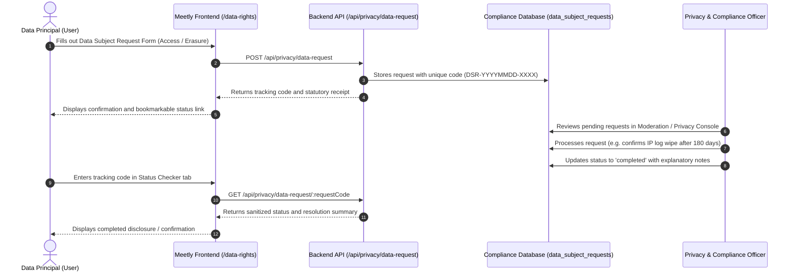

# PRIVACY & DATA GOVERNANCE MAP: MEETLY
**Platform:** Meetly (Anonymous Random Text & Video Chat)  
**Operator:** Evolix Studio  
**Date:** October 29, 2026  
**Governing Standard:** Digital Personal Data Protection Act, 2023 (DPDP Act) & CERT-In Directions 2022  
**Document Status:** Production Technical Data Map

---

## 1. DATA GOVERNANCE PRINCIPLES IN MEETLY

Meetly is engineered around the principle of **Privacy-by-Design** and **Data Minimization**:
1. **Zero Registration:** Users do not provide names, phone numbers, email addresses, passwords, or social login credentials to chat.
2. **Ephemeral Communication:** Live chat messages, typing events, and WebRTC signaling messages reside solely in volatile RAM during active rooms and are permanently destroyed upon disconnection.
3. **Cryptographic Pseudonymity:** Session tokens are cryptographically signed with HMAC-SHA256 (`token = id.signature`). When stored in audit logs or database tables (e.g., safety reports), sessions are hashed (`SHA-256(session_id)`), ensuring the raw session identifier is never stored alongside moderation records.
4. **Separation of Concerns:** Advertising scripts (Google AdSense) are strictly barred from loading or running during active text chats, video calls, or queue matchmaking.

---

## 2. COMPREHENSIVE DATA LIFECYCLE INVENTORY

| Data Category | Data Elements | Source / Ingestion Point | Storage Mechanism | Retention Period | Lawful Grounds (DPDP Act, 2023) | Cross-Border Flow |
| :--- | :--- | :--- | :--- | :--- | :--- | :--- |
| **Anonymous Session Identity** | Cryptographically signed session ID, creation timestamp, media mode (`text`/`video`), language tag, topic tags. | Browser handshake via `chat.session.create`. | In-memory session table (`Map<string, Session>`); stored in client `sessionStorage`. | 24 hours from creation or until manual exit / next stranger. | Section 4 & 6: Explicit consent for service delivery. | No cross-border transfer; kept on host server. |
| **Live Chat Messages** | Text content, sender flag, ephemeral timestamp. | Sent by users via authenticated WebSocket (`/api/chat/live`). | Volatile RAM ring buffer (max 10 recent messages in memory for partner reconnection/safety audit context). | Destroyed immediately upon room termination or partner skip. Zero disk/database persistence. | Section 4 & 6: Communication transmission consent. | No cross-border storage; transmitted point-to-point. |
| **WebRTC Video / Audio Media** | Real-time audio streams, live video frames, peer network packets. | Local device camera and microphone. | **Direct Peer-to-Peer** (WebRTC). Never passes through Meetly application servers or databases. | Real-time streaming only. Zero recording, zero storage. | Section 4: Explicit consent when joining video mode. | Direct peer-to-peer transmission (subject to peer geographic location). |
| **WebRTC Signaling Metadata** | Session Description Protocol (SDP) offers/answers, ICE candidate IP/port tuples. | Browser WebRTC engine via WebSocket signaling. | Volatile memory in signaling handler during negotiation handshake. | Ephemeral (seconds); wiped as soon as peer connection state transitions to connected. | Section 4: Technical necessity for peer connection establishment. | Relayed through host server; STUN/TURN fallback. |
| **Network & Access Logs** | Client public IP address, User-Agent header, request method, route, HTTP status code. | Reverse proxy / Node.js HTTP server. | Encrypted server audit log files / Docker log streams. | **180 days rolling**, strictly conforming to CERT-In Direction No. 20(3)/2022-CERT-In. | Section 7(b): Legitimate use for statutory compliance. | Stored within Indian jurisdiction or compliant host. |
| **Safety Reports** | Reporter session hash, reported session hash, category, optional user excerpt (max 500 chars), timestamp. | In-chat report modal (`/api/trpc/chat.report`). | MySQL database (`safety_reports` table) with in-memory fallback. | 180 days rolling for security audit and repeat abuse prevention. | Section 7(b) & Section 8(5): Intermediary due diligence and safety. | Hosted in primary deployment database. |
| **Grievance Tickets (IT Rules 3(2))** | Complainant name, email address, category, subject, description, evidence link, ticket code, status, resolution notes. | Dedicated web form (`POST /api/grievance/submit`). | MySQL database (`grievance_tickets` table) with in-memory fallback. | 3 years from resolution date (statutory limitation period for legal dispute records). | Section 7(b): Compliance with IT Rules, 2021 statutory mandate. | Stored in primary database within operator jurisdiction. |
| **Data Subject Requests (DPDP Act)** | Request code, request type (access, erasure, correction), contact email, session hash, status, response notes. | Dedicated web form (`POST /api/privacy/data-request`). | MySQL database (`data_subject_requests` table) with in-memory fallback. | 3 years from fulfillment date (evidence of regulatory compliance). | Section 7(b): Compliance with DPDP Act, 2023 statutory mandate. | Stored in primary database within operator jurisdiction. |
| **Client Local State** | Theme preference (`dark`/`light`), terms accepted flag, audio notification preference. | User interactions in UI. | Browser `localStorage` / `sessionStorage`. | Managed entirely by client browser; cleared on site data reset. | Section 4: Technical necessity / user convenience. | Stored exclusively on user's local device. |
| **Advertising & Cookie Data (Conditional)** | Google AdSense ad requests, anonymized cookie identifiers, telemetry (only on eligible static pages). | Third-party Google AdSense script (when `ENABLE_ADS=true`). | Managed by Google on user's device and Google servers. | Controlled by Google Privacy Policy; zero interaction with chat data. | Section 4: Consent / AdSense disclosure. | Handled by Google global advertising network. |

---

## 3. DATA PRINCIPAL RIGHTS WORKFLOW (DPDP ACT, 2023)

Under Chapter III of the DPDP Act 2023, data principals have rights to access, correction, erasure, and grievance redressal:

### 3.1 Handling Erasure Requests on an Account-Less Platform
Because Meetly does not maintain permanent user accounts or chat logs:
1. When a user submits an **Erasure Request**:
   - The Privacy Officer reviews the request against the mandatory CERT-In 180-day log retention rule.
   - Live session data is already ephemeral (0 days retention).
   - Under Section 8(7) of the DPDP Act, personal data retention is lawful where required by other applicable laws (such as CERT-In Directions 2022).
   - The user is provided a formal confirmation:
     > *"Meetly maintains zero permanent user accounts and records zero chat or video transcripts. System network connection logs are scheduled for automatic purged deletion at the expiration of the 180-day statutory holding period required by Indian cybersecurity regulations."*

---

## 4. CROSS-BORDER DATA FLOW ANALYSIS

1. **Host Server Location:**  
   The primary application server and MySQL database must be hosted within the Republic of India or in countries not restricted by the Central Government under Section 16 of the DPDP Act.
2. **STUN / TURN Infrastructure:**  
   STUN servers (e.g., Google STUN `stun:stun.l.google.com:19302`) only discover public IP addresses and ports to facilitate NAT traversal. They do not store or inspect user media packets.
3. **Peer-to-Peer Direct Media:**  
   When two users connect in video mode, their encrypted media packets flow directly between their two browser endpoints. If User A is in India and User B is in the UK, media packets naturally traverse international internet routes. The user is informed of this peer-to-peer reality before starting video chat.

---

## 5. SECURITY CONTROLS PROTECTING PERSONAL DATA

* **TLS 1.3 Encryption:** All HTTP and WebSocket traffic is protected via HTTPS/WSS in production.
* **Database Isolation:** MySQL database connections utilize secure SSL, parameterized queries through Drizzle ORM, and environment-enforced credentials.
* **Hash Anonymization:** Raw session IDs are transformed using SHA-256 before any persistence in reporting tables.
* **Zero Chat Storage:** The codebase contains no database tables, file writers, or logging statements that save user chat messages.

